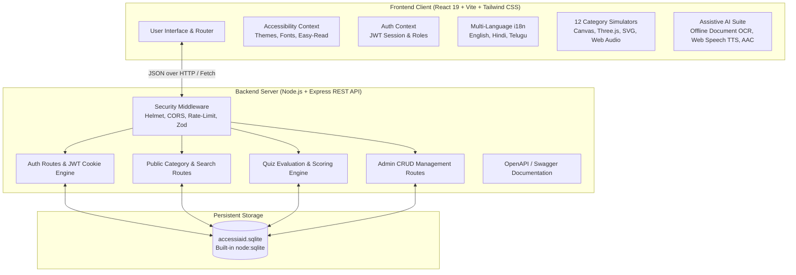
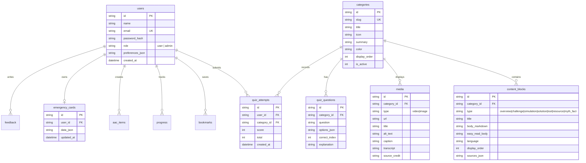

# Sahay (सहाय) — Universal Assistive Technology & Disability Hub

> A full-stack, WCAG 2.2 Level AA-compliant web application providing disability education, interactive empathy simulations, working assistive utilities, and Indian legal rights resources (RPwD Act 2016).

---

## 🚀 Quick Start Guide

### Prerequisites
* **Node.js**: v18.0.0 or higher
* **npm**: v9.0.0 or higher

### 1. Installation
In the project root directory, install dependencies:
```bash
# Install root and server packages
npm install
npm install --prefix server
```

### 2. Seed the SQLite Database
Initialize the database with 8 disability categories, content blocks, quizzes, media with transcripts, and demo user accounts:
```bash
npm run seed
```

### 3. Run the Development Server
Launch both the Express backend API and the Vite React frontend concurrently with a single command:
```bash
npm run dev
```

* **Frontend Application**: [http://localhost:5173](http://localhost:5173)
* **Backend REST API**: [http://localhost:5000](http://localhost:5000)
* **Interactive Swagger API Docs**: [http://localhost:5000/api/docs](http://localhost:5000/api/docs)

---

## 🔑 Demo Login Credentials

| Role | Email | Password | Access Capabilities |
| :--- | :--- | :--- | :--- |
| **Administrator** | `admin@sahay.org` | `AdminPass123!` | Full Admin Dashboard (`/admin`), Metrics, CRUD for categories, media & quizzes |
| **Legacy Admin** | `admin@accessiaid.org` | `AdminPass123!` | Full Administrator privileges |
| **Student / User** | `user@sahay.org` | `UserPass123!` | Profile (`/profile`), Quiz tracking, Custom AAC boards, Saved bookmarks |

*(One-click demo login buttons are also provided directly on the `/login` page for fast presentation access).*

---

## 🏗️ System Architecture



---

## 🗄️ Entity-Relationship (ER) Diagram



---

## 📡 REST API Endpoints Overview

| Method | Endpoint | Access | Description |
| :--- | :--- | :--- | :--- |
| **GET** | `/api/health` | Public | Server health & SQLite connection check |
| **POST** | `/api/v1/auth/register` | Public | Register new account (hashes password, signs JWT) |
| **POST** | `/api/v1/auth/login` | Public | Authenticate user & issue `httpOnly` cookie |
| **POST** | `/api/v1/auth/logout` | Public | Clear authentication cookie |
| **GET** | `/api/v1/auth/me` | Authenticated | Retrieve current user profile and role |
| **GET** | `/api/v1/categories` | Public | List all 8 disability pillars with block counts |
| **GET** | `/api/v1/categories/:slug` | Public | Get category details with 8 blocks, media & quiz |
| **POST** | `/api/v1/quiz/:id/submit` | Public / User | Grade quiz answers and return explanations |
| **GET** | `/api/v1/search?q=` | Public | Full-text search across categories & blocks |
| **GET / PUT** | `/api/v1/me/preferences` | Authenticated | Read/update accessibility display preferences |
| **GET / POST** | `/api/v1/me/bookmarks` | Authenticated | View and add bookmarked topic blocks |
| **GET / POST** | `/api/v1/me/aac` | Authenticated | Custom AAC speech communication cards |
| **GET / PUT** | `/api/v1/me/emergency-card` | Authenticated | Digital Emergency Medical ID data |
| **POST** | `/api/v1/feedback` | Public | Submit user feedback and ratings |
| **GET** | `/api/v1/admin/stats` | Admin Only | System metrics (users, average quiz score, feedback) |
| **POST / PUT** | `/api/v1/admin/categories` | Admin Only | Create/update disability categories |
| **POST / DEL** | `/api/v1/admin/media` | Admin Only | Add captioned videos with full transcripts |
| **POST / DEL** | `/api/v1/admin/quiz` | Admin Only | Add interactive quiz questions |

---

## 🧪 Automated Testing
Run the automated test suite covering authentication, role guards, category retrieval, quiz grading, and Swagger spec validation:
```bash
npm test
```
All 12 end-to-end tests run against SQLite and pass with 0 failures.

---

## 📄 Key Project Documentation
* **[docs/ACCESSIBILITY.md](file:///docs/ACCESSIBILITY.md)**: Full WCAG 2.2 Level AA compliance matrix across Perceivable, Operable, Understandable, and Robust principles.
* **[docs/PRESENTATION_NOTES.md](file:///docs/PRESENTATION_NOTES.md)**: 10-slide capstone pitch deck outline and **5-minute live demo script**.
* **[PROJECT_SPEC.md](file:///PROJECT_SPEC.md)**: Original technical specification and requirements.
